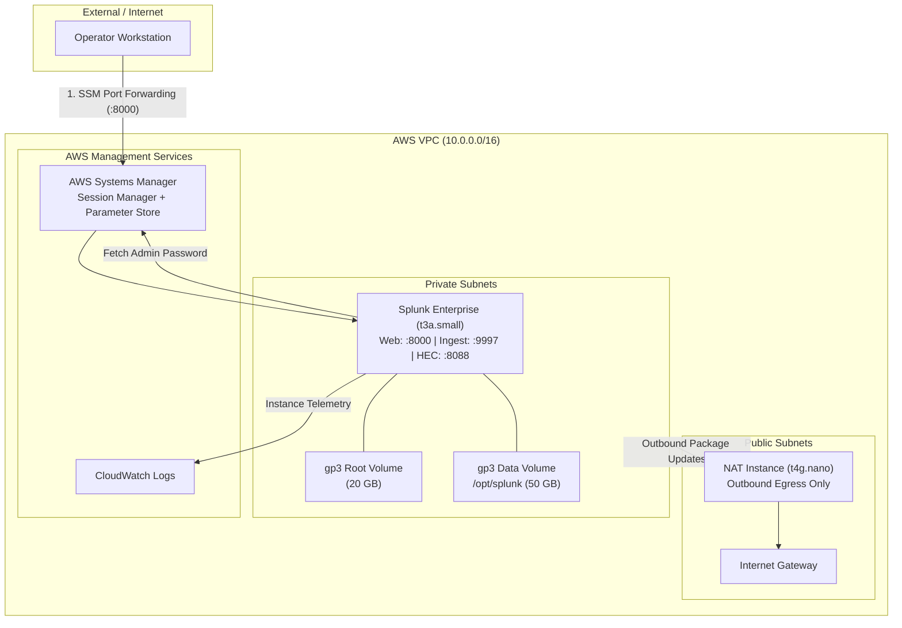

# tofu-splunk-aws

[](https://github.com/VisiCore/tofu-splunk-aws/actions/workflows/tofu-ci.yml)
[](https://opentofu.org)
[](LICENSE)

Production-grade, cost-optimized Splunk Enterprise environment on AWS managed with [OpenTofu](https://opentofu.org). Configured by default for **24/7 continuous operation**, zero-trust network isolation, and seamless management via the AWS Console UI and AWS Systems Manager.

---

## What & Why

This repository provisions a turnkey Splunk Enterprise environment on AWS:

- **Splunk Enterprise (24/7, Default Enabled)**: Single indexer and search head with an automated installation pipeline. Automatically fetches, verifies SHA512 checksums, formats/mounts a dedicated gp3 EBS data volume at `/opt/splunk`, seeds a secure admin password from AWS Systems Manager (SSM) Parameter Store, and starts the service at boot.
- **24/7 Continuous Operation**: Instances run 24/7 with automated shutdown disabled by default. You retain full control over runtime via the AWS Console UI or OpenTofu.
- **Cost-Optimized Network Architecture**: Dedicated VPC with public and private subnets, paired with a custom `t4g.nano` NAT instance (~$3.71/mo) that eliminates the expensive AWS Managed NAT Gateway (~$32/mo).
- **Private by Default**: Workload instances reside in private subnets with no public IPs. Operators access Splunk Web securely via AWS SSM Session Manager port forwarding without needing a bastion host or VPN.
- **Optional Cribl Workloads (Disabled by Default)**: Modular support for Cribl Stream (Linux) and Cribl Edge (Windows) can be toggled on demand via `enable_cribl = true`.

---

## Architecture



---

## Network & Port Reference

| Port | Protocol | Scope | Description |
| :--- | :--- | :--- | :--- |
| **8000** | TCP | Private (or Restricted Public) | Splunk Web UI |
| **9997** | TCP | VPC Internal / Allowed CIDRs | Splunk forwarder ingest (Splunk-to-Splunk / S2S) |
| **8088** | TCP | VPC Internal / Allowed CIDRs | Splunk HTTP Event Collector (HEC) |
| **8089** | TCP | VPC Internal / Restricted | Splunk REST API and deployment management |
| **22** | TCP | Disabled by default | SSH access (SSM Session Manager preferred) |
| **4200** | TCP | VPC Internal (when Cribl enabled) | Cribl Stream Web UI & Worker API |

---

## Cost

Estimated on-demand pricing in `us-east-2` for continuous **24/7 operation**:

| Component | Sizing | 24/7 Monthly Cost |
| :--- | :--- | :--- |
| **Splunk Enterprise** | `t3a.small` (2 vCPU, 2 GB RAM) | ~$13.72 |
| **Splunk Storage** | 20 GB root + 50 GB data (gp3) | ~$5.60 |
| **NAT Instance** | `t4g.nano` (2 vCPU, 0.5 GB RAM ARM64) + 8 GB gp3 | ~$3.71 |
| **Total (24/7 Continuous)** | **Splunk Enterprise + Shared Plumbing** | **~$23.03 / month** |

> [!TIP]
> Run `tofu output -json estimated_cost | jq .` after any apply to view live calculated costs based on your enabled components.

---

## Quickstart: How to Run Locally

### 1. Prerequisites

- **OpenTofu**: `>= 1.10`
  - **macOS (Homebrew)**: `brew install opentofu`
  - **Linux**: See [OpenTofu installation docs](https://opentofu.org/docs/intro/install/)
  - **Nix / Direnv**: If using Nix, simply run `direnv allow` to automatically load OpenTofu, AWS CLI v2, TFLint, and tools.
- **AWS CLI v2**: Configured with credentials for your target AWS account (`aws configure`, AWS SSO, or environment variables).

### 2. Configure Local Variables

Clone the repository and create your local `terraform.tfvars`:

```bash
git clone https://github.com/VisiCore/tofu-splunk-aws.git
cd tofu-splunk-aws

# Copy the local template
cp terraform.tfvars.example terraform.tfvars
```

Edit `terraform.tfvars` to set your operator public IP:

```hcl
environment          = "dev"
aws_region           = "us-east-2"
admin_ip_cidrs       = ["YOUR_PUBLIC_IP/32"]   # Find via: curl -4 ifconfig.me
enable_splunk        = true
splunk_public_access = false                   # false = private subnet, access via SSM
enable_auto_stop     = false                   # 24/7 continuous operation
```

---

### 3. State Backend Setup

#### Option A: Quick Local Testing (Sandbox)
To test locally without setting up an AWS S3 bucket:

```bash
tofu init -backend=false
```

#### Option B: Team S3 Remote State (Production & Staging)
To use remote state with native S3 lockfiles (no DynamoDB table needed):

1. **Create the state bucket** (one-time per AWS account):

```bash
ACCOUNT_ID=$(aws sts get-caller-identity --query Account --output text)
REGION=us-east-2
BUCKET="tofu-splunk-aws-state-${REGION}-${ACCOUNT_ID}"

aws s3api create-bucket \
  --bucket "$BUCKET" --region "$REGION" \
  --create-bucket-configuration LocationConstraint="$REGION"

aws s3api put-bucket-versioning \
  --bucket "$BUCKET" --versioning-configuration Status=Enabled

aws s3api put-bucket-encryption \
  --bucket "$BUCKET" \
  --server-side-encryption-configuration '{"Rules":[{"ApplyServerSideEncryptionByDefault":{"SSEAlgorithm":"AES256"}}]}'

aws s3api put-public-access-block \
  --bucket "$BUCKET" \
  --public-access-block-configuration BlockPublicAcls=true,IgnorePublicAcls=true,BlockPublicPolicy=true,RestrictPublicBuckets=true
```

2. **Initialize with the environment backend file**:

Update `<ACCOUNT_ID>` in `envs/dev.s3.tfbackend`, then run:

```bash
tofu init -backend-config=envs/dev.s3.tfbackend
```

---

### 4. Deploy Infrastructure

```bash
tofu plan
tofu apply
```

After deployment completes (~3–5 minutes for instance boot and Splunk package initialization), inspect connection details:

```bash
tofu output connection_info
tofu output access_credentials
```

---

### 5. Accessing Splunk Web

#### Mode 1: Private Access via AWS SSM Port Forwarding (Recommended)
When `splunk_public_access = false` (the default), Splunk has no public IP. Forward port 8000 securely over AWS Systems Manager:

```bash
# Start SSM port forwarding session
aws ssm start-session \
  --target $(tofu output -raw splunk_instance_id) \
  --document-name AWS-StartPortForwardingSession \
  --parameters '{"portNumber":["8000"],"localPortNumber":["8000"]}'
```

Then open your browser to **[http://localhost:8000](http://localhost:8000)**.

#### Mode 2: Direct Public Access
When `splunk_public_access = true`, Splunk Web is available directly at `http://<splunk_public_ip>:8000` from the IP addresses allowlisted in `admin_ip_cidrs`.

#### Retrieving Credentials
- **Username**: `admin`
- **Password**: Displayed in `tofu output access_credentials` or retrieved directly from SSM Parameter Store:
  ```bash
  aws ssm get-parameter \
    --name "/dev/splunk/admin-password" \
    --with-decryption \
    --query "Parameter.Value" \
    --output text
  ```

---

## 24/7 Operations & Management

By default, instances run **24/7**. Manage instance state directly through standard AWS interfaces:

### Starting / Stopping Instances via AWS Console UI
1. Navigate to **EC2 Console** -> **Instances**.
2. Filter by tag: `Project = splunk-aws`.
3. Select the Splunk and NAT instances.
4. Click **Instance state** -> **Stop instances** (or **Start instances**).

*(EBS storage remains preserved while stopped; compute charges pause).*

### Optional Auto-Stop Guardrail
If you ever wish to enforce scheduled nightly shutdowns (e.g. for non-production development testing), set:

```hcl
enable_auto_stop         = true
stop_schedule_expression = "cron(0 8 * * ? *)" # Nightly at 08:00 UTC
```

---

## Teardown

To permanently remove all provisioned AWS resources:

```bash
tofu destroy
```

---

## Testing & CI

This repository uses [OpenTofu tests](https://opentofu.org/docs/language/tests/) with mock AWS providers. You can run the entire test suite locally without AWS credentials:

```bash
tofu init -backend=false
tofu test -no-color
```

Continuous Integration is executed using the shared VisiCore workflow in [`VisiCore/.github`](https://github.com/VisiCore/.github):

```yaml
jobs:
  opentofu:
    uses: VisiCore/.github/.github/workflows/opentofu.yml@main
    with:
      run_test: true
      run_tflint: true
```

---

## License

[MIT](LICENSE)
